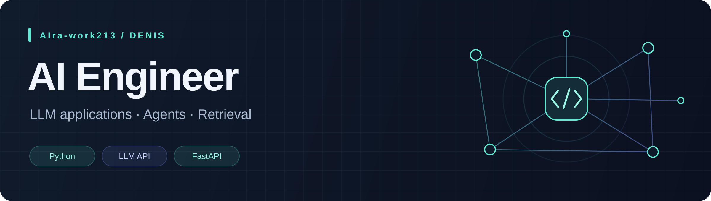

  

  <b>Открыт к предложениям на позиции Intern / Junior AI Engineer</b> 
  Студент ИТМО · Python · LLM-приложения · NLP

  <a href="https://t.me/akira1"><b>Telegram ↗</b></a> &nbsp; / &nbsp;
  <a href="mailto:denissadovoj5@gmail.com"><b>Email ↗</b></a> &nbsp; / &nbsp;
  <a href="#projects">Проекты</a> &nbsp; / &nbsp;
  <a href="#stack">Технологии</a>

 

<h2>Разрабатываю приложения с LLM и поиском</h2>

Я Денис. Учусь в ИТМО и разрабатываю проекты на Python: LLM-чат-бота для анализа данных, гибридный поиск вакансий и модели машинного обучения. Работаю с подготовкой данных, обучением моделей, API и запуском в Docker.

Интересны задачи, где нужно связать LLM с данными и инструментами, оценить качество результата и собрать работающий сервис.

 

<h2 id="projects">Избранные проекты</h2>

<table>
<tr>
<td width="50%" valign="top">
  <h3>01 &nbsp; HackChange · MWS Tables</h3>
  
<b>LLM-агент для анализа постов VK</b>

  
Командный хакатонный проект, моя роль — ML Engineer. Агент формирует запросы к MWS Tables, получает данные и отвечает на вопросы о публикациях телеком-операторов.

  
В репозитории: цикл агента, сбор и обновление данных, FastAPI и чат-интерфейс Streamlit.

  
<code>LLM API</code> <code>OpenRouter</code> <code>FastAPI</code> <code>Streamlit</code>

  
<a href="https://github.com/AIra-work213/HackChange_MWS_tables"><b>Открыть проект ↗</b></a> · <a href="https://github.com/AIra-work213/HackChange_MWS_tables/blob/main/server/model.py">Код агента</a>

</td>
<td width="50%" valign="top">
  <h3>02 &nbsp; NLP Vacancies Ranking</h3>
  
<b>Гибридный поиск вакансий</b>

  
Поиск по словам и смыслу: BM25 и E5 объединяются через RRF. API, интерфейс, пайплайны оценки, хранение артефактов и мониторинг собраны в одном проекте.

  
<b>NDCG@10: 0.901</b> на test в бенчмарке проекта. Весь бенчмарк: 12 запросов и 254 оценки релевантности.

  
<code>PyTorch</code> <code>pgvector</code> <code>MLflow</code> <code>DVC</code>

  
<a href="https://github.com/AIra-work213/NLP_vacancies_ranking"><b>Открыть проект ↗</b></a> · <a href="https://github.com/AIra-work213/NLP_vacancies_ranking/tree/main/src/nlp_ranker">Исходный код</a>

</td>
</tr>
<tr>
<td width="50%" valign="top">
  <h3>03 &nbsp; ML Salary Predictor</h3>
  
<b>Предсказание зарплаты по тексту вакансии</b>

  
RuBERT с регрессионной головой предсказывает нижнюю и верхнюю границы зарплаты. В проекте есть очистка данных, обучение, инференс, FastAPI и Telegram-бот.

  
Обучение использует ruBERT-tiny2, валидационную выборку и сохранение лучшей модели по loss.

  
<code>PyTorch</code> <code>Transformers</code> <code>FastAPI</code> <code>Docker</code>

  
<a href="https://github.com/AIra-work213/ML_salary_predictor"><b>Открыть проект ↗</b></a> · <a href="https://github.com/AIra-work213/ML_salary_predictor/blob/master/training/train.py">Код обучения</a>

</td>
<td width="50%" valign="top">
  <h3>04 &nbsp; Fraudulent Transactions</h3>
  
<b>Выявление мошеннических транзакций</b>

  
Учебный ML-проект на несбалансированных данных: сравнение Logistic Regression, Random Forest и CatBoost с подбором гиперпараметров.

  
В репозитории: ноутбук с экспериментами, сохранённая модель CatBoost и скрипт расчёта метрик.

  
<code>CatBoost</code> <code>scikit-learn</code> <code>Pandas</code> <code>Jupyter</code>

  
<a href="https://github.com/AIra-work213/Fraudulent_transactions"><b>Открыть проект ↗</b></a> · <a href="https://github.com/AIra-work213/Fraudulent_transactions/blob/main/models_grid_search.ipynb">Ноутбук</a>

</td>
</tr>
</table>

Метрики приведены для конкретных наборов данных из README проектов; условия оценки описаны в соответствующих репозиториях.

 

<h2 id="stack">Технологии в моих проектах</h2>

<table>
<tr><td><b>LLM и агенты</b></td><td>OpenRouter · OpenAI Python SDK · запросы LLM к данным через инструменты</td></tr>
<tr><td><b>NLP и поиск</b></td><td>Transformers · sentence-transformers · E5 · BM25 · CatBoost</td></tr>
<tr><td><b>Backend и данные</b></td><td>Python · FastAPI · Pydantic · SQLAlchemy · PostgreSQL · pgvector · Redis</td></tr>
<tr><td><b>ML и эксперименты</b></td><td>PyTorch · scikit-learn · Pandas · MLflow · DVC</td></tr>
<tr><td><b>Запуск и качество</b></td><td>Docker Compose · Git · pytest · Ruff · mypy · Prometheus · Grafana</td></tr>
</table>

 

  <b>Обсудим работу над LLM-приложениями?</b>  
  <a href="https://t.me/akira1">@akira1</a> &nbsp; · &nbsp;
  <a href="mailto:denissadovoj5@gmail.com">denissadovoj5@gmail.com</a>

